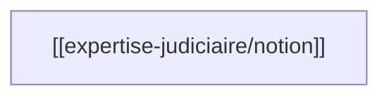

# wiki-batch-produce

> Production **en série** d'articles Karpathy à partir de sources web déjà extraites
> (`raw/web/<sujet>/*.md`). **Déterministe** : pas d'appel LLM, pas d'invention de
> contenu. Le contenu vient **intégralement** de la source. Idempotent, sériel,
> rollback en cas d'article invalide.

## Quand l'utiliser

Pour transformer un dossier `raw/web/<sujet>/` (déjà peuplé par `wiki-extract`) en
articles wiki `wiki/<sujet>/<notion>.md` en **une seule commande**, sans sous-agent.

- **Voie rapide** : 1 URL = 1 notion, sources homogènes, pas de chapitrage.
- **Voie sémantique** (par défaut) : `wiki-ingest` (décomposition pilotée par l'agent).

❌ **Pas pour** : PDF / EPUB (→ `wiki-ingest` : chapitrage `#chK` à respecter).
❌ **Pas pour** : un seul article (écriture à la main, `wiki-ingest write-article`).
❌ **Pas pour** : > 30 articles / run (découper par sujet).

## CLI

```sh
python scripts/batch_produce.py [--config <wiki.config.json>] \
    --inbox-dir raw/web/<sujet> --subject <sujet> [--skip-sync] [--dry-run]
```

> `--config` est **optionnel** : auto-découverte `$MIMIR_CONFIG` → profil → `~/.config/mimir` → `./`.

| Option        | Effet                                                    |
| ------------- | -------------------------------------------------------- |
| `--inbox-dir` | Chemin **relatif à `work_root`** du dossier source (ex. `raw/web/expertise-judiciaire`). |
| `--subject`   | Sujet destination (nom du dossier `wiki/<sujet>/`).      |
| `--skip-sync` | Pas de synchro (par défaut, on l'évite dans un batch).    |
| `--dry-run`   | Calcule sans rien écrire.                                |

## Procédure

Le script enchaîne, **par source** :

1. **Scan** : liste les `*.md` top-level de `inbox-dir` ; ignore `INDEX.md`, `_status.md`,
   `_assets/`, fichiers cachés.
2. **Filtre web** : un fichier `.pdf` / `.epub` est **refusé** avec message
   d'aiguillage vers `wiki-ingest` (qui honore le chapitrage `#chK`). Idem si le
   frontmatter déclare un chapitrage (`chapters:` non vide).
3. **Lecture frontmatter** : `title` + `source` (URL). Sans ces deux clés → skip
   (`↩️`). Si les `tags` ne contiennent pas `--subject` → warning, on continue.
4. **Idempotence** : `wiki/<subject>/<slug>.md` existe → skip (`↩️`). Sinon
   `slug = slugify(title)[:60]` ; collision → `-2`, `-3`, …
5. **Écriture** : produit le corps Karpathy **à partir de la source** (sections
   `## Définition`, `## Points clés`, `## Mermaid`, `## Relations`, `## Sources`),
   assemble frontmatter **flow-list** (`sources: [...]`, `tags: [...]`), écrit
   atomiquement via `iohelpers.atomic_write_text` (confiné à `work_root`).
6. **Validation post-écriture** :
   - ≥ 4 sections `## ` ;
   - bloc ` ```mermaid ` ouvert **et** fermé ;
   - taille ≥ 500 octets.
   Échec → `os.remove(dest)` (rollback) + `❌ <slug> — <reason>`.
7. **Sériel** : pas de parallélisme (évite races, rollbacks concurrents, ledger
   corrompu).
8. **Finalize par source** : pour chaque source traitée avec succès, un
   `wiki-ingest finalize --source … --sha … --articles …` met à jour le ledger et
   `_status.md` (statut `compilé`).
9. **Audit best-effort** : `wiki-index audit` est lancé une fois à la fin. Son
   résultat est **loggé sans abort** (un wiki tout neuf peut avoir des liens
   non encore résolus).

## Frontière stricte : web uniquement

| Cas                                | Verdict                                  |
| ---------------------------------- | ---------------------------------------- |
| `raw/web/<sujet>/foo.md`           | ✅ traité                                |
| `raw/web/<sujet>/foo.pdf`          | ❌ refus → « utilise `wiki-ingest` »     |
| `raw/web/<sujet>/foo.epub`         | ❌ refus → « utilise `wiki-ingest` »     |
| `raw/web/<sujet>/foo.md` avec `chapters:` | ❌ refus → chapitrage ≠ notion atomique |
| `raw/web/<sujet>/<sujet>--<slug>.md` (Web Clipper) | ⚠️ documenté hors-scope : à regrouper en amont |

## Format produit

Frontmatter (gabarit `FRONTMATTERS.md §1`, flow-list) :

```yaml
---
title: "Titre de la page"
subject: expertise-judiciaire
tags: [expertise-judiciaire, source]
sources: ["raw/web/expertise-judiciaire/foo.md", "https://exemple.org/article"]
created: 2026-06-14
updated: 2026-06-14
---
```

Corps Karpathy (jamais de dump brut — sections structurées à partir de la source) :

```markdown
# Titre de la page

> Résumé d'une ligne (première phrase non vide du corps de la source).

## Définition
[Reformulation à partir des premiers paragraphes.]

## Points clés
[3-5 puces synthétiques à partir des phrases porteuses de la source.]

## Mermaid


## Relations
- _À enrichir par `wiki-ingest` ou manuellement._ Aucune invention automatique.

## Sources
- [[raw/web/expertise-judiciaire/foo.md]] — page d'origine.
- https://exemple.org/article — URL source.
```

## Déterminisme et garde-fous

1. **Idempotence** : `wiki/<subject>/<slug>.md` existe → skip (`↩️`).
2. **Validation post-écriture** : ≥ 4 sections `##`, bloc ` ```mermaid ` fermé,
   taille ≥ 500 octets. Échec → `os.remove(dest)` (rollback), `❌`.
3. **Sériel** : pas de parallélisme.
4. **Confinement** : toutes les écritures via `iohelpers.atomic_write_text` /
   `guard.assert_within` (le crash `safe_path non importé` du run Wharram est
   traité structurellement par le bootstrap partagé).
5. **Frontmatter flow-list** : `sources: [...]`, `tags: [...]` — garantit le
   parsing par `frontmatter.parse_frontmatter` (cf. `add-block-list-frontmatter`
   côté lecture).

## Références

- Format Karpathy + Mermaid + no-dump : spec `batch-produce::karpathy-article-format`
  + spec `mimir-invariants::mermaid-mandatory` + spec `mimir-invariants::no-dump-in-wiki` ;
  gabarits frontmatter : [`../_shared-references/FRONTMATTERS.md`](../_shared-references/FRONTMATTERS.md).
- Template de corps Karpathy : [`references/karpathy-template.md`](references/karpathy-template.md).
- Slug ASCII, NFD/NFC, écriture confinée, ledger : [`../_shared-references/scripts/`](../_shared-references/scripts/).
- Spec normative : `openspec/specs/batch-produce` (web-only-batch-scope, idempotent-per-article-production, karpathy-format-with-post-write-validation, flow-list-frontmatter-output, serial-execution-and-per-source-ledger-finalize).
