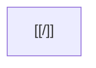

# Karpathy template — `wiki-batch-produce`

Gabarit de corps d'article produit par `wiki-batch-produce` (spec `batch-produce`).
Strict **déterministe** : pas d'invention, pas d'appel LLM. Sections peuplées à
partir du **contenu de la source web** uniquement.

## Forme générale

```markdown
# <Titre de la notion>

> <Résumé d'une ligne — première phrase non vide du corps, ≤ 200 caractères.>

## Définition
<Reformulation de 1-3 phrases à partir des premiers paragraphes de la source.>

## Points clés
- <3 à 5 puces synthétiques, tirées de phrases porteuses du corps.>
- <…>
- <…>

## Mermaid


## Relations
- _Aucune relation automatique._ À enrichir par `wiki-ingest` ou manuellement.

## Sources
- <Liste des sources : chemin raw + URL d'origine.>
```

## Règles

- **H1** = `title` du frontmatter source.
- **Callout `>`** = première phrase non vide du corps, **trimée** à 200 caractères
  max, suivie de `…` si tronquée. C'est ce que l'`INDEX` par sujet utilise comme
  description d'article.
- **`## Définition`** : 1 à 3 phrases reprises des premiers paragraphes de la
  source (hors titres, hors listes). Cible ≈ 300-500 caractères.
- **`## Points clés`** : 3 à 5 puces synthétiques. Si la source n'a pas assez
  de matière pour 3 puces significatives, on garde ce qu'on peut et l'article
  sera probablement **trop court** → validation post-écriture → rollback.
- **`## Mermaid`** : un bloc ` ```mermaid ` **toujours présent**, **toujours
  fermé**, avec au minimum un nœud qui porte le wikilink de l'article. C'est un
  placeholder — l'enrichissement est manuel.
- **`## Relations`** : section toujours présente, marquée « à enrichir ». On ne
  *fabrique* pas de relations inter-notions en batch.
- **`## Sources`** : reprend `source:` du frontmatter source (URL) + chemin raw
  relatif à `work_root`. Si plusieurs sources frontmatter, toutes listées.

## Validation post-écriture (implémentée dans `batch_produce.py`)

1. **Au moins 4 sections `## `** (Définition, Points clés, Mermaid, Relations —
   `## Sources` étant la 5e et dépassant la cible de 4).
2. **Bloc ` ```mermaid ` ouvert ET fermé** : la sous-chaîne `` ```mermaid ``
   apparaît, **et** la sous-chaîne `` ``` `` (fermeture) apparaît après elle.
3. **Taille ≥ 500 octets** : un article squelette qui n'aurait produit que la
   définition et un titre reste en deçà ; on rollback plutôt que de polluer le
   wiki.

Échec d'un de ces trois critères → `os.remove(dest)` + ligne `❌ <slug> — <reason>`.

## Idempotence

- `wiki/<sujet>/<slug>.md` existe déjà (slug ASCII NFC) → `↩️`, aucune
  réécriture. C'est la garantie qu'on peut relancer le batch sans rien casser.
- Slug = `slugify(title)[:60]` ; collision intra-sujet → `-2`, `-3`, … (cf.
  `skills/_shared-references/scripts/slug.py`).
