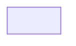

# Format d'un rapport de recherche (`type: research-report`)

> Spécification de gabarit — annexe de référence à `wiki-research/SKILL.md`.

## 1. Périmètre

Un **rapport de recherche** est un livrable de `reading-grids/` qui synthétise
N clips web (5 à 15 en pratique) sur un sujet texte donné. Il se distingue
d'une **grille de lecture** (`type: reading-grid`, palier v3→v4) par :

| Aspect                | Grille de lecture                       | Rapport de recherche                      |
| --------------------- | --------------------------------------- | ----------------------------------------- |
| Source                | 1 ouvrage (PDF/EPUB chapitré)           | N articles web (clips)                    |
| Type de livrable      | Ordre de lecture reconstitué            | Synthèse sémantique                       |
| Production du contenu | Déterministe (charpente + nav)          | Sémantique (agent)                        |
| `type:`               | `reading-grid`                          | `research-report`                         |
| Sections              | 1 par chapitre (`Ch. K — …`)            | `## Angle`, `## Synthèse`, etc.           |
| Sources               | 1 chemin raw + chapitrage                | N URLs (clips) + N chemins raw            |

## 2. Frontmatter (gabarit exact)

```yaml
---
title: "<sujet humain>"
type: research-report
topic: "<sujet humain>"
subject: <sujet-slug>
created: 2026-06-14
updated: 2026-06-14
sources:
  - https://exemple.org/article-1
  - https://exemple.org/article-2
tags: [report, <sujet-slug>, ...]
---
```

- **`type: research-report`** : clé discriminante consommée par `wiki-index`
  (les grilles classiques sont `type: reading-grid`).
- **`subject:`** : slug ASCII du sujet. Cohérent avec le `subject:` des
  articles produits par `wiki-batch-produce` et avec le `subject:` injecté
  par `wiki-research` dans chaque clip (cf. `_tag_clip_with_subject`).
- **`created:`** : posé par `scaffold`, **préservé** par `update`.
- **`updated:`** : rebasculé à aujourd'hui à chaque `update`.
- **`sources:`** : recalculé par `update` depuis l'état réel de
  `raw/web/**/*.md` (filtré par `subject:`).

## 3. Corps (plan indicatif)

```
# <title>

> Résumé d'une ligne (synthèse globale, première phrase du corps).

## Angle
_Poser la question de recherche, le périmètre, les angles morts._

## Synthèse
_3 à 6 paragraphes denses, reformulant les clips — pas de copier-coller._

## Points de friction
_Contradictions, désaccords, zones d'ombre entre les sources clippées._

## Mermaid


## Sources
_Liste des clips ingérés (renvois auto-générés par `update`)._

## Renvois wiki
_Liens vers les articles `[[<sujet>/<notion>]]` déjà produits par ailleurs._
```

L'agent n'est **pas tenu** de suivre ce plan à la lettre : c'est une
**charpente indicative** (cf. palier v3→v4 de `wiki-reading-grid` —
les grilles de lecture mêlent charpente déterministe et zone éditoriale).
Le rapport est, lui, **entièrement éditorial** (zéro déterministe dans
le corps), car la valeur ajoutée est **la synthèse**.

## 4. Renvois (wikilinks)

Deux familles de cibles :

1. **Vers les clips** : `[[raw/web/<slug>-<date>]]` (préfixée depuis
   `work_root`). Vérifié par `wikilinks.resolve` (1er candidat = `cfg.work_root/<rel>`).
2. **Vers les articles wiki du sujet** : `[[<sujet>/<notion>]]` (forme
   relative à `wiki/`). Vérifié par `wikilinks.resolve` (2e candidat).

Toute cible qui ne résout pas est signalée `🔗 invalide` par `update`.

## 5. Idempotence

`update` :

- **préserve** `created:` et le **corps** du rapport ;
- **n'écrase** que `updated:` et `sources:` (alignés sur l'état réel).

Conséquence : l'agent peut **re-rédiger** le corps manuellement entre deux
`update` sans risquer de voir son travail écrasé. Pour forcer un scaffold
vierge, supprimer `reading-grids/<sujet>.md` puis relancer `scaffold`.

## 6. Liens avec `wiki-index`

`wiki-index` reconnaît `type: research-report` comme une entrée valide de
`reading-grids/` :

- **regenerate** : la grille est listée dans l'INDEX principal et dans
  `reading-grids/_INDEX.md`, avec son `topic:` comme libellé.
- **audit** : les wikilinks du rapport sont audités au même titre que ceux
  des grilles classiques (lien cassé / orphelin / CJK parasite).
- **fix** : les réparations de wikilinks s'appliquent (matching override →
  identité → préfixe → mots).
